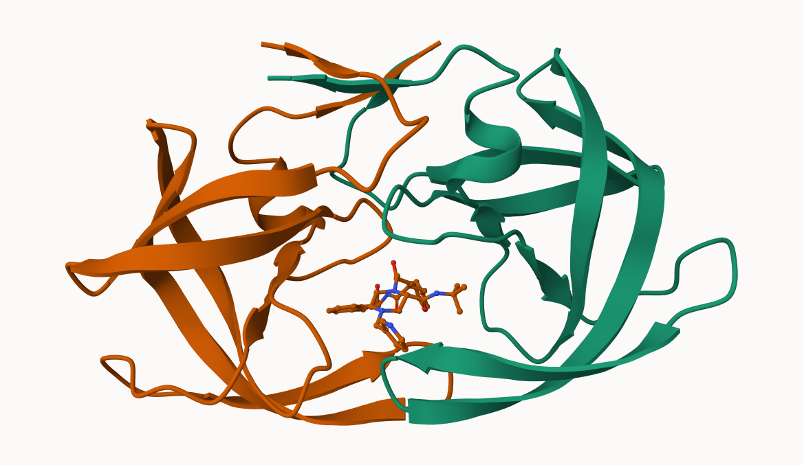
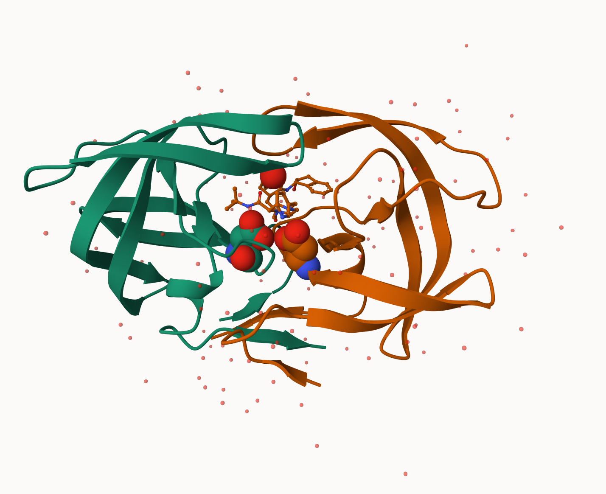
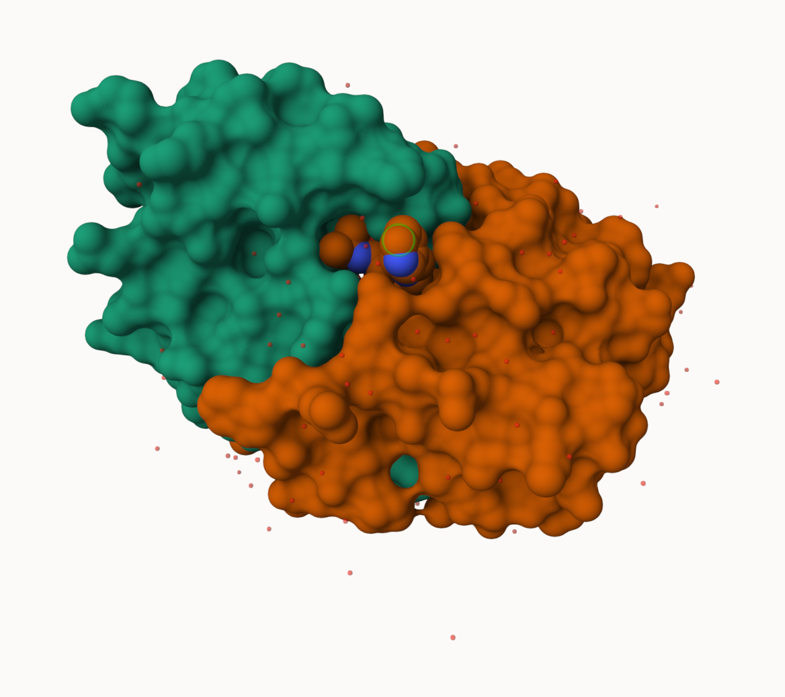

## Background

Goals:

- Characterize and interpret biological molecules and their assembles

Motivations: 
- Structural bioinformatics can take you from sequence to structure to function 
- Structure is more conserved than sequence 
- Structure is encoded in sequence

PDB database is the main repository of biomolecular data:

The `[]()` is how you insert a hyperlink

We can "scrape" the PDB statistics data with the **datapasta** package.

### PDB statistics

```{r, echo=FALSE}
pdb <- data.frame(
  stringsAsFactors = FALSE,
       check.names = FALSE,
           Molecular.Type = c("Protein (only)",
                              "Protein/Oligosaccharide","Protein/NA",
                              "Nucleic acid (only)","Other","Oligosaccharide (only)",
                              "Total"),
         Xray = c(184948, 10729, 9345, 3222, 178, 11, 208433),
                EM = c(25926, 4048, 7539, 347, 27, 1, 37888),
               NMR = c(12907, 34, 288, 1599, 35, 6, 14869),
       Integrative = c(365L, 8L, 27L, 3L, 4L, 0L, 407L),
  Multiple.methods = c(232L, 11L, 8L, 15L, 0L, 1L, 267L),
           Neutron = c(86L, 1L, 0L, 3L, 0L, 0L, 90L),
             Other = c(32L, 0L, 0L, 1L, 0L, 4L, 37L),
             Total = c(224496, 14831, 17207, 5190, 244, 23, 261991)
       )
pdb
```

> Q1: What percentage of structures in the PDB are solved by X-Ray and Electron Microscopy.

```{r}
total.ind <- pdb$Molecular.Type == "Total"

n.xray <- pdb$Xray[total.ind]
n.EM <- pdb$EM[total.ind]
n.total <- pdb$Total[total.ind]

round(n.xray/n.total * 100, 2)
round(n.EM/n.total * 100, 2)

```
About 79.56% of the strucutres are resolved by X-Ray and 14.46% are resolved by EM. 

> Q2: What percentage of structures in the PDB are protein?

```{r}
sum(pdb[1, "Total"]) / sum(pdb$Total) * 100   
```
42.84% are proteins. 

> Q3: What percentage of known protein sequences have a known protein structure? 

```{r}
round(224496/149430635 * 100, 2)
```
0.15% have known protein structures. 

## Mol-star viewer

> Q4: Water molecules normally have 3 atoms. Why do we see just one atom per water molecule in this structure?

The hydrogen is very small so you can't really view it on Mol-star. 

> Q5: There is a critical “conserved” water molecule in the binding site. Can you identify this water molecule? What residue number does this water molecule have

The water molecule is HOH308. 

An image from Mol-star of HIV-protease(or HIV-PR)


The catalytic ASP25 residues and the important active site water in relation to the inhibitor

Surface display showing active site cavity

> Q6: Generate and save a figure clearly showing the two distinct chains of HIV-protease along with the ligand. You might also consider showing the catalytic residues ASP 25 in each chain and the critical water (we recommend “Ball & Stick” for these side-chains). Add this figure to your Quarto document.
Discussion Topic: Can you think of a way in which indinavir, or even larger ligands and substrates, could enter the binding site?

The homodimers of the protein move and when that happens there is a change for larger ligands to enter the binding site. 


## Reading structural data in R 

We can use the **bio3d package** to work with structural dta in R: 

```{r}
library(bio3d)

hiv <- read.pdb("1hsg")
hiv
```
```{r}
head(hiv$atom)
```
```{r}
pdbseq(hiv)
```
```{r}
#| eval: false
library(bio3dview)
view.pdb(hiv)
```
```{r}
#| eval: false
asp <- atom.select(hiv, resno = 25)
view.pdb(hiv,
         highlight = asp,
         highlight.style = "spacefill",
         backgroundColor = "pink")
```

> Q7: How many amino acid residues are there in this pdb object? 

There are 198 AA residues.

> Q8: Name one of the two non-protein residues? 

MK1(1) or HOH (127)

> Q9: How many protein chains are in this structure? 

There are 2 protein chains, A and B. 

> Q10. Which of the packages above is found only on BioConductor and not CRAN? 

msa

> Q11. Which of the above packages is not found on BioConductor or CRAN?: 

bio3dview


> Q12. True or False? Functions from the pak package can be used to install packages from GitHub and BitBucket? 

True

## Predict Protein Dynamics

Let's predict the internal dynamics and flexibility of ADK: 

```{r}
adk <- read.pdb("6s36")
adk
```

```{r}
m <- nma(adk)
plot(m)
```
```{r}
mktrj(m, file="adk_dynamics.pdb")
```

```{r}
#| eval: false
view.nma(m)
```

> Q13. How many amino acids are in this sequence, i.e. how long is this sequence?

214 AA

## Annotate collected PDB structures 

```{r}
hits <- NULL
hits$pdb.id <- c('1AKE_A','6S36_A','6RZE_A','3HPR_A','1E4V_A','5EJE_A','1E4Y_A','3X2S_A','6HAP_A','6HAM_A','4K46_A','3GMT_A','4PZL_A')

files <- get.pdb(hits$pdb.id, path="pdbs", split=TRUE, gzip=TRUE)

# Align releated PDBs
pdbs <- pdbaln(files, fit = TRUE, exefile="msa")

# Vector containing PDB database codes
ids <- basename.pdb(pdbs$id)

anno <- pdb.annotate(ids)
unique(anno$source)
```
### PCA

```{r}
# Perform PCA
pc.xray <- pca(pdbs)
plot(pc.xray)
```
```{r}
# Calculate RMSD
rd <- rmsd(pdbs)

# Structure-based clustering
hc.rd <- hclust(dist(rd))
grps.rd <- cutree(hc.rd, k=3)

plot(pc.xray, 1:2, col="grey50", bg=grps.rd, pch=21, cex=1)
```
```{r}
#Plotting results with ggplot2
library(ggplot2)
library(ggrepel)

df <- data.frame(PC1=pc.xray$z[,1], 
                 PC2=pc.xray$z[,2], 
                 col=as.factor(grps.rd),
                 ids=ids)

p <- ggplot(df) + 
  aes(PC1, PC2, col=col, label=ids) +
  geom_point(size=2) +
  geom_text_repel(max.overlaps = 20) +
  theme(legend.position = "none")
p
```
## Normal Mode Analysis

```{r}
# NMA of all structures
modes <- nma(pdbs)

plot(modes, pdbs, col=grps.rd)

```

> Q14. What do you note about this plot? Are the black and colored lines similar or different? Where do you think they differ most and why?

The black and colored lines are similar in some places and very different in other places because those spots are where the kinase will change conformation to bind its substrate while the other regions don't really move. 
