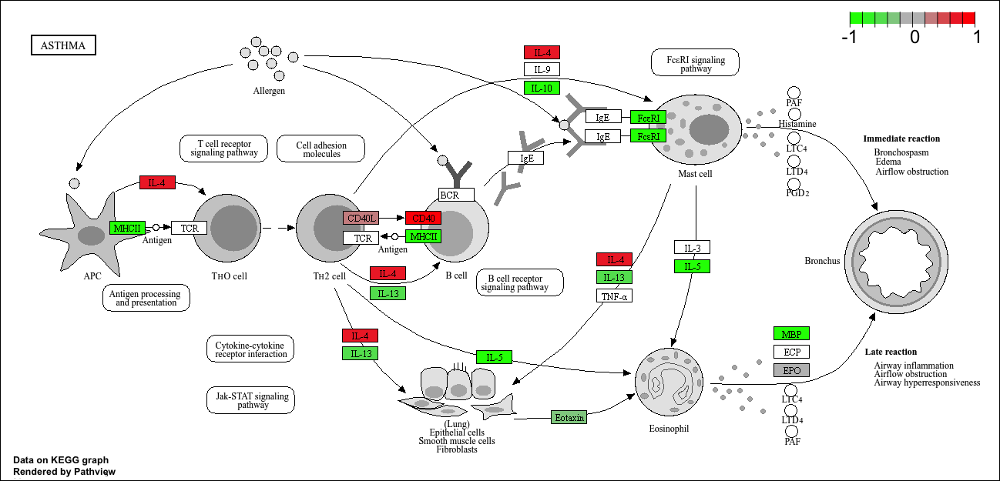
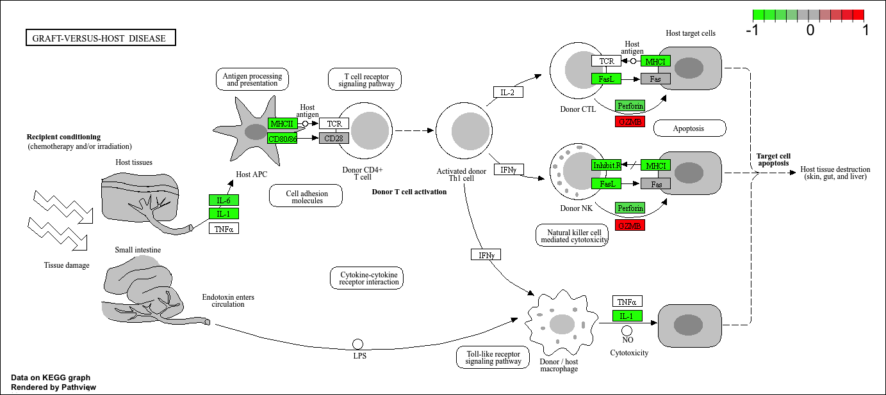
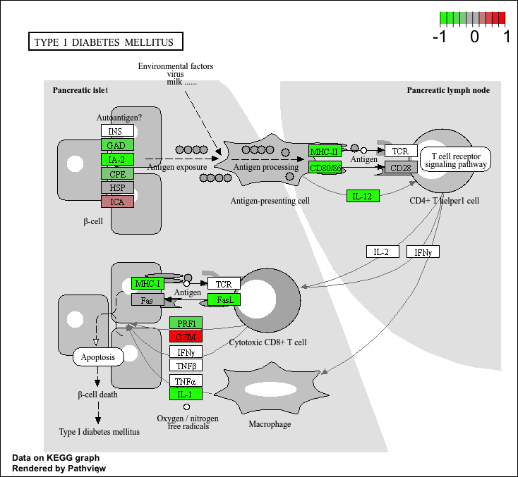

```{r, message = FALSE}
library(BiocManager)
library(DESeq2)
```

```{r}
# Complete the missing code
counts <- read.csv("airway_scaledcounts.csv", row.names=1)
metadata <-  read.csv("airway_metadata.csv")
head(counts)
head(metadata)
```
```{r}
dim(counts)
```

> Q1.  How many genes are in this dataset?

There are 38,694 genes in the dataset. 

```{r}
controlnumber <- (metadata$dex == "control")
sum(controlnumber)
```

> Q2. How many ‘control’ cell lines do we have?

There are 4 control lines. 

## Analysis

Let's extract out just the "control" samples and then a separate data.frame with the "treated" samples. 

```{r}
control.inds <- metadata$dex == "control"
control.counts <- counts[ ,control.inds]
dim(control.counts)
head(control.counts)
```

```{r}
treated.inds <- metadata$dex == "treated"
treated.counts <- counts[ ,treated.inds]
dim(treated.counts)
head(treated.counts)
```
> Q3. How would you make the above code in either approach more robust? Is there a function that could help here?

Rowmeans is a better function for this. 

> Q4. Follow the same procedure for the treated samples (i.e. calculate the mean per gene across drug treated samples and assign to a labeled vector called treated.mean)

```{r}
control.mean <- rowMeans( control.counts )
head(control.mean)
```

```{r}
treated.mean <- rowMeans(treated.counts)
head(treated.mean)
```

```{r}
meancounts <- data.frame(control.mean, treated.mean)
head(meancounts)
```
> 
Q5 (a). Create a scatter plot showing the mean of the treated samples against the mean of the control samples. Your plot should look something like the following.

```{r}
plot(meancounts)
```

Q5 (b).You could also use the ggplot2 package to make this figure producing the plot below. What geom_?() function would you use for this plot?

```{r}
library(ggplot2)
ggplot(meancounts, aes(control.mean, treated.mean)) +
  geom_point()
```

> Q6. Try plotting both axes on a log scale. What is the argument to plot() that allows you to do this?

```{r}
ggplot(meancounts, aes(control.mean, treated.mean)) +
  geom_point(alpha = 0.2) + 
  scale_x_log10() + 
  scale_y_log10() + 
  labs(
    x = "Control_Log",
    y = "Treated_Log", 
    title = "Log Scale Control vs. Treated"
  )
```
```{r}
meancounts$log2fc <- log2(meancounts[,"treated.mean"]/meancounts[,"control.mean"])
head(meancounts)
```

We often use the concept of "fold-change" this is jus the log fraction of treated over control

get rid of the zero counts 

```{r}
to.keep <- rowSums(meancounts[,1:2]) > 10
mycounts <- meancounts[to.keep, ]
dim(mycounts)

```

> Q. how many genes do we have left after this filter?

There are 16490 genes left after filtering. 

```{r}
up.ind <- mycounts$log2fc >= 2
down.ind <- mycounts$log2fc < (-2)

sum(up.ind)
sum(down.ind)
```


> Q8 and Q9. How many genes are "upregulated" with a log2fc >= +2? and downregulated?

127 genes are upregulated or have a log2fc of greater than or equal to 2. 139 genes are downregulated

> Q7. What is the purpose of the arr.ind argument in the which() function call above? Why would we then take the first column of the output and need to call the unique() function?

The arr.ind argument tells you where every zero is in the matrix and by taking the first column you figure out when genes have zero values. 

> Q10. Do you trust these results? Why or why not?

No because we haven't actually done any statistics on these results. Fold changes in genes that are expressed at very low levels are probably not actually biologically significant and these results might also be driven by expression being low or high in one or two samples. 

## Setting up DESeq2

```{r, message=FALSE}
library(DESeq2)
citation("DESeq2")
```
For DESeq we need to supply: 
- countData
- colData (ourmetadata)
- design (this is what you are comparing)
```{r}
dds <- DESeqDataSetFromMatrix(countData=counts, 
                              colData=metadata, 
                              design=~dex)
dds
```
```{r}
vsd <- vst(dds, blind = FALSE)
plotPCA(vsd, intgroup = c("dex"))
```
```{r}
pcaData <- plotPCA(vsd, intgroup=c("dex"), returnData=TRUE)
head(pcaData)
```
```{r}
# Calculate percent variance per PC for the plot axis labels
percentVar <- round(100 * attr(pcaData, "percentVar"))
```

```{r}
ggplot(pcaData) +
  aes(x = PC1, y = PC2, color = dex) +
  geom_point(size =3) +
  xlab(paste0("PC1: ", percentVar[1], "% variance")) +
  ylab(paste0("PC2: ", percentVar[2], "% variance")) +
  coord_fixed() +
  theme_bw()
```
```{r}
dds <- DESeq(dds)
res <- results(dds)
res
```

```{r}
summary(res)
```
```{r}
res05 <- results(dds, alpha=0.05)
summary(res05)
```
## Adding Annotation Data

```{r}
library("AnnotationDbi")
library("org.Hs.eg.db")

```
```{r}
columns(org.Hs.eg.db)
```
```{r}
res$symbol <- mapIds(org.Hs.eg.db,
                     keys=row.names(res), # Our genenames
                     keytype="ENSEMBL",        # The format of our genenames
                     column="SYMBOL",          # The new format we want to add
                     multiVals="first")
```
```{r}
head(res)
```
> Q11. Run the mapIds() function two more times to add the Entrez ID and UniProt accession and GENENAME as new columns called res$entrez, res$uniprot and res$genename.

```{r}
res$entrez <- mapIds(org.Hs.eg.db,
                     keys=row.names(res),
                     column="ENTREZID",
                     keytype="ENSEMBL",
                     multiVals="first")

res$uniprot <- mapIds(org.Hs.eg.db,
                     keys=row.names(res),
                     column="UNIPROT",
                     keytype="ENSEMBL",
                     multiVals="first")

res$genename <- mapIds(org.Hs.eg.db,
                     keys=row.names(res),
                     column="GENENAME",
                     keytype="ENSEMBL",
                     multiVals="first")

head(res)
```
```{r}
ord <- order( res$padj )
#View(res[ord,])
head(res[ord,])
```
```{r}
write.csv(res[ord,], "deseq_results.csv")
```

## Volcano Plots

```{r}
plot( res$log2FoldChange,  -log(res$padj), 
      xlab="Log2(FoldChange)",
      ylab="-Log(P-value)")
```
```{r}
plot( res$log2FoldChange,  -log(res$padj), 
 ylab="-Log(P-value)", xlab="Log2(FoldChange)")

# Add some cut-off lines
abline(v=c(-2,2), col="darkgray", lty=2)
abline(h=-log(0.05), col="darkgray", lty=2)
```
```{r}
# Setup our custom point color vector 
mycols <- rep("gray", nrow(res))
mycols[ abs(res$log2FoldChange) > 2 ]  <- "red" 

inds <- (res$padj < 0.01) & (abs(res$log2FoldChange) > 2 )
mycols[ inds ] <- "blue"

# Volcano plot with custom colors 
plot( res$log2FoldChange,  -log(res$padj), 
 col=mycols, ylab="-Log(P-value)", xlab="Log2(FoldChange)" )

# Cut-off lines
abline(v=c(-2,2), col="gray", lty=2)
abline(h=-log(0.1), col="gray", lty=2)
```

```{r}
library(ggplot2)
ggplot(res) + 
  aes(log2FoldChange, -log(padj)) + 
  geom_point() +
  geom_vline(xintercept=c(+2, -2), col = "red") + 
  geom_hline(yintercept= -log(0.05), col = "blue")
```
Lets add some color

```{r}
my_cols <- rep("gray", nrow(res))


# Up-regulated: big positive fold change AND significant
my_cols[res$log2FoldChange >= 2 & res$padj < 0.05] <- "red"

# Down-regulated: big negative fold change AND significant
my_cols[res$log2FoldChange < -2 & res$padj < 0.05] <- "blue"

ggplot(res) + 
  aes(log2FoldChange, -log(padj)) + 
  geom_point(colour = my_cols) +
  geom_vline(xintercept = c(-2, 2), col = "black", linetype = "dashed") + 
  geom_hline(yintercept = -log(0.05), col = "black", linetype = "dashed")
```


```{r}
library(EnhancedVolcano)
```

```{r}
x <- as.data.frame(res)

EnhancedVolcano(x,
    lab = x$symbol,
    x = 'log2FoldChange',
    y = 'pvalue')
```
## Pathway Analysis with R and Bioconductor

```{r}
library(pathview)
library(gage)
library(gageData)

data(kegg.sets.hs)

# Examine the first 2 pathways in this kegg set for humans
head(kegg.sets.hs, 2)
```
```{r}
foldchanges = res$log2FoldChange
names(foldchanges) = res$entrez
head(foldchanges)
```

```{r}
# Get the results
keggres = gage(foldchanges, gsets=kegg.sets.hs)
attributes(keggres)
```

```{r}
# Look at the first three down (less) pathways
head(keggres$less, 3)
```
```{r}
pathview(gene.data=foldchanges, pathway.id="hsa05310")
```


```{r}
# A different PDF based output of the same data
pathview(gene.data=foldchanges, pathway.id="hsa05310", kegg.native=FALSE)
```
> Q12. Can you do the same procedure as above to plot the pathview figures for the top 2 down-reguled pathways?

```{r}
pathview(gene.data=foldchanges, pathway.id="hsa05332")
```

```{r}
pathview(gene.data=foldchanges, pathway.id="hsa04940")
```

```{r}
plotCounts(dds, gene="ENSG00000103196", intgroup="dex")
```
```{r}
# Return the data
d <- plotCounts(dds, gene="ENSG00000103196", intgroup="dex", returnData=TRUE)
head(d)

library(ggplot2)
ggplot(d, aes(dex, count, fill=dex)) + 
  geom_boxplot() + 
  scale_y_log10() + 
  ggtitle("CRISPLD2")
```

