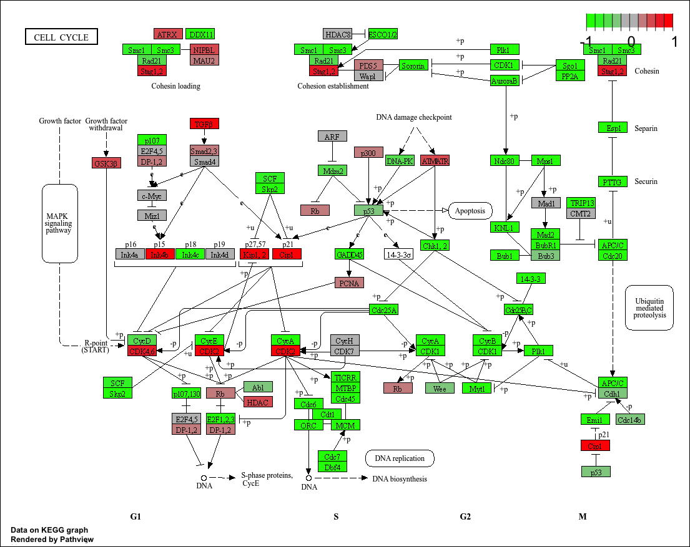

## Section 1. Differential Expression Analysis

```{r}
#| message: false
#| warning: false
library(DESeq2)
```

```{r}
metaFile  <- "GSE37704_metadata.csv"
countFile <- "GSE37704_featurecounts.csv"

# Import metadata and take a peek
colData <- read.csv(metaFile, row.names = 1)
head(colData)
```

```{r}
# Import countdata
countData <- read.csv(countFile, row.names = 1)
head(countData)
```


> Q. Complete the code below to remove the troublesome first column from countData.

```{r}
# Note we need to remove the odd first $length col
countData <- as.matrix(countData[, -1])
head(countData)
```

Check that the columns of `countData` now match the rows of `colData`:

```{r}
all(colnames(countData) == rownames(colData))
```

> Q. Complete the code below to filter countData to exclude genes (i.e. rows) where we have 0 read count across all samples (i.e. columns).

```{r}
# Filter count data where you have 0 read count across all samples.
countData <- countData[rowSums(countData) > 0, ]
head(countData)
```

```{r}
nrow(countData)
```

15,975 genes left over after filtering

### Running DESeq2

```{r}
dds <- DESeqDataSetFromMatrix(countData = countData,
                              colData   = colData,
                              design    = ~condition)
dds <- DESeq(dds)
```

```{r}
dds
```


```{r}
res <- results(dds, contrast = c("condition", "hoxa1_kd", "control_sirna"))
```

> Q. Call the summary() function on your results to get a sense of how many genes are up or down-regulated at the default 0.1 p-value cutoff.

```{r}
summary(res)
```

At the default adjusted p-value cutoff of 0.1, 4349 genes are up-regulated and 4396 genes are down-regulated in the HOXA1 knockdown. 

### Volcano plot


```{r}
plot(res$log2FoldChange, -log(res$padj))
```

> Q. Improve this plot by completing the below code, which adds color and axis labels.

```{r}
# Make a color vector for all genes
mycols <- rep("gray", nrow(res))

# Color red the genes with absolute fold change above 2
mycols[abs(res$log2FoldChange) > 2] <- "red"

# Color blue those with adjusted p-value less than 0.01
#  and absolute fold change more than 2
inds <- (res$padj < 0.01) & (abs(res$log2FoldChange) > 2)
mycols[inds] <- "blue"

plot(res$log2FoldChange, -log(res$padj), col = mycols,
     xlab = "Log2(FoldChange)", ylab = "-Log(P-value)")
abline(v = c(-2, 2), lty = 2, col = "darkgray")
abline(h = -log(0.01), lty = 2, col = "darkgray")
```

### Adding gene annotation


> Q. Use the mapIds() function multiple times to add SYMBOL, ENTREZID and GENENAME annotation to our results by completing the code below.

```{r}
library("AnnotationDbi")
library("org.Hs.eg.db")

columns(org.Hs.eg.db)
```

```{r}
res$symbol <- mapIds(org.Hs.eg.db,
                     keys      = row.names(res),
                     keytype   = "ENSEMBL",
                     column    = "SYMBOL",
                     multiVals = "first")

res$entrez <- mapIds(org.Hs.eg.db,
                     keys      = row.names(res),
                     keytype   = "ENSEMBL",
                     column    = "ENTREZID",
                     multiVals = "first")

res$name   <- mapIds(org.Hs.eg.db,
                     keys      = row.names(res),
                     keytype   = "ENSEMBL",
                     column    = "GENENAME",
                     multiVals = "first")

head(res, 10)
```

> Q. Finally for this section let's reorder these results by adjusted p-value and save them to a CSV file in your current project directory.

```{r}
res <- res[order(res$pvalue), ]
write.csv(res, file = "deseq_results.csv")
```

## Section 2. Pathway Analysis


```{r}
library(pathview)
library(gage)
library(gageData)

data(kegg.sets.hs)
data(sigmet.idx.hs)

# Focus on signaling and metabolic pathways only
kegg.sets.hs <- kegg.sets.hs[sigmet.idx.hs]

# Examine the first 3 pathways
head(kegg.sets.hs, 3)
```


```{r}
foldchanges <- res$log2FoldChange
names(foldchanges) <- res$entrez
head(foldchanges)
```


```{r}
# Get the results
keggres <- gage(foldchanges, gsets = kegg.sets.hs)
attributes(keggres)
```


```{r}
# Look at the first few down (less) pathways
head(keggres$less)
```

```{r}
# And the first few up (greater) pathways
head(keggres$greater)
```


```{r}
pathview(gene.data = foldchanges, pathway.id = "hsa04110")
```




A PDF version of the graph (different layout):

```{r}
# A different PDF based output of the same data
pathview(gene.data = foldchanges, pathway.id = "hsa04110", kegg.native = FALSE)
```

Top 5 up-regulated pathways

```{r}
## Focus on top 5 upregulated pathways here for demo purposes only
keggrespathways <- rownames(keggres$greater)[1:5]

# Extract the 8 character long IDs part of each string
keggresids <- substr(keggrespathways, start = 1, stop = 8)
keggresids
```

```{r}
pathview(gene.data = foldchanges, pathway.id = keggresids, species = "hsa")
```


> Q. Can you do the same procedure as above to plot the pathview figures for the top 5 down-regulated pathways?

```{r}
## Top 5 downregulated pathways
keggrespathways.down <- rownames(keggres$less)[1:5]

keggresids.down <- substr(keggrespathways.down, start = 1, stop = 8)
keggresids.down
```

```{r}
pathview(gene.data = foldchanges, pathway.id = keggresids.down, species = "hsa")
```

## Section 3. Gene Ontology (GO)

We can do the same analysis with GO. `go.sets.hs` has all GO terms and `go.subs.hs` is a named list of indexes for the BP, CC, and MF subsets. Here we focus on Biological Process (BP).

```{r}
data(go.sets.hs)
data(go.subs.hs)

# Focus on Biological Process subset of GO
gobpsets <- go.sets.hs[go.subs.hs$BP]

gobpres <- gage(foldchanges, gsets = gobpsets, same.dir = TRUE)

lapply(gobpres, head)
```

This matches the KEGG result.

## Section 4. Reactome Analysis

Reactome is a database of biological molecules and their relation to pathways and processes. 

```{r}
sig_genes <- res[res$padj <= 0.05 & !is.na(res$padj), "symbol"]
print(paste("Total number of significant genes:", length(sig_genes)))
```

```{r}
write.table(sig_genes, file = "significant_genes.txt",
            row.names = FALSE, col.names = FALSE, quote = FALSE)
```


> Q. What pathway has the most significant "Entities p-value"? Do the most significant pathways listed match your previous KEGG results? What factors could cause differences between the two methods?

The pathway with the most significant p-value is "Cell Cycle, Mitotic". this is followed by "Cell Cycle" and "Cell Cycle Checkpoints" and this does match the pathways that were identified by KEGG which also had cell cycle as a major down-regulated pathway. The different pathway databases could be causing differences because they might have different genes for different pathways. Also Reactome just looks at what pathways are over represented and we only uploaded the significant genes which would change the pathways that are ouput. 


## Session Information

```{r}
sessionInfo()
```
